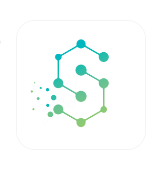

<div align="center">



# Naseej | نَسيج
### A Multi-Tenant Healthcare Platform for Connected Patient Information
**منصة الرعاية الصحية السحابية المترابطة والسجلات الطبية المتصلة**

[](https://www.typescriptlang.org/)
[](https://nodejs.org/)
[](https://www.postgresql.org/)
[](https://react.dev/)
[](#5-automated-tests)

*Academic graduation prototype. 100% synthetic demo data. Arabic (RTL) first, English (LTR) fully supported.*

</div>

---

## 1. What Naseej is

Naseej gives each patient a portable, organized electronic medical file and gives centers the tools to support it. The patient record is the center of the product; appointments and center operations exist to support it.

Core ideas:

1. **Connecting is not exposing.** A patient can belong to several centers, but a center never sees another center's records without the patient's explicit, scoped, unexpired consent.
2. **Clinician in the loop.** Visits, prescriptions and lab results are drafts until a clinician approves them. Nothing is shown to the patient before that.
3. **Traceability.** Every record keeps its source center, author, provenance (clinician-authored, patient-uploaded, patient-reported, imported) and review state.
4. **No autonomous medicine.** The software never diagnoses, prescribes or changes treatment. AI output is only ever an unreviewed suggestion for a clinician.
5. **Server-side security.** Tenant scoping, role checks, delegation checks and audit logging are enforced by the API; the UI only hides what the server would refuse.
6. **Bilingual.** Arabic RTL and English LTR everywhere in the app.

### What is implemented

| Area | Status |
|---|---|
| Public site (landing, features, workflow, demo request) and login | Implemented |
| Tenant isolation, role walls, audit log (append-only guards) | Implemented, covered by automated tests |
| **Patient** workspace: approved record, timeline, document library and upload, medications, appointments, questions and symptoms, cross-center consent, caregiver management | Implemented |
| **Caregiver** workspace: patient-granted, scoped, expiring access (view record / manage appointment requests / message the care team) | Implemented (migration 003) |
| **Doctor** workspace: day overview, patient record, visits, prescriptions, lab orders and results, document review, patient questions inbox, reception messages | Implemented |
| **Reception** workspace: day/week/month calendar, booking, check-in, patient registration and administrative search, messages to clinicians | Implemented |
| **Center manager** workspace: working hours, center calendar with load against capacity, staff and roles, services, reports, coordination oversight, activity log | Implemented (aggregates only, no clinical records) |
| Platform administrator and care coordinator workspaces | Implemented (unchanged by the five-workspace rebuild) |
| Longitudinal timeline and cross-center consent | Implemented |
| AI document reading (OCR, classification, candidate facts with page and passage) | **Code complete, off by default.** Needs a provider key; never run against a real provider yet. See section 4 |
| **Settings** page for every role (`#/<role>/settings`): profile, patient contact and emergency details, caregiver access, password, language and appearance | Implemented (account API, no migration) |
| **In-app notifications**: bell with unread count, inbox, typed deep links, one quick action (confirm appointment) | Implemented (migration 004). Updates are periodic, not real time. See [docs/notifications.md](docs/notifications.md) |
| **Installable app (PWA)**: manifest, icons, versioned static cache, update prompt, offline notice; `/api` is never cached | Implemented, not tested on physical devices. See [docs/pwa.md](docs/pwa.md) |
| Email and push notifications, privacy-request workflow, voice dictation, external identity provider | **Not implemented** |

Details per role: [docs/workspaces.md](docs/workspaces.md).

---

## 2. Technology

- **Frontend:** React 18, Vite, TypeScript, plain CSS with design tokens. The visual system is documented in [DESIGN.md](DESIGN.md).
- **Backend:** Node.js, Express, TypeScript, `pg`. Authentication is email and password with a JWT behind a replaceable `IAuthProvider`.
- **Database:** PostgreSQL 16+, plain SQL migrations in `database/migrations`.
- **Tests:** Vitest and Supertest (backend, against a real PostgreSQL), Vitest (frontend).
- **Files:** protected local storage outside any web root (`storage/protected/`), served only through authorized routes.
- **Optional AI:** provider adapters in `backend/src/services/ai` for Google Gemini (plain HTTPS, free tier available) and Anthropic (`@anthropic-ai/sdk`).

Repository layout:

```text
backend/    Express API, services, migration and seed scripts, tests
frontend/   React app (public site in src/pages, signed-in app in src/app)
database/   migrations/ (001 to 004), rollback/, seeds/
docs/       architecture, API, test plan, user guide, workspaces, team guide
```

---

## 3. Quick start (short version)

The full step-by-step guide for new team members, including Git rules, is in **[docs/team-guide.md](docs/team-guide.md)**.

Requirements: Node.js 20 or newer, npm 10+, PostgreSQL 16+, Git.

```bash
git clone https://github.com/haniyousrii18/NASEEJ.git
cd NASEEJ

npm install                      # installs backend and frontend (npm workspaces)
cp .env.example .env             # then set DB_PASSWORD (and DB_* if different)

# create the database once (psql):  CREATE DATABASE naseej_dev;

npm --prefix backend run migrate # creates tables (001 to 004)
npm --prefix backend run seed    # synthetic demo data

npm run dev                      # API on :5000 and app on :3000
```

Open <http://localhost:3000>.

### Demo accounts
All use the password **`Password123!`** (synthetic, local use only).

| Role | Email | Center |
|---|---|---|
| Platform administrator | `admin@naseej.health` | System-wide (no clinical access) |
| Center manager | `manager.noor@naseej.health` | Al-Noor |
| Doctor | `doctor.noor@naseej.health` | Al-Noor |
| Reception | `reception.noor@naseej.health` | Al-Noor |
| Care coordinator | `coordinator.noor@naseej.health` | Al-Noor |
| Patient | `patient@naseej.health` | Al-Noor and Al-Amal |
| Caregiver (view records and appointments, no messaging) | `caregiver.noor@naseej.health` | Delegation from the demo patient |
| Center manager / doctor (second tenant) | `manager.amal@naseej.health`, `doctor.amal@naseej.health` | Al-Amal (used to test isolation) |

---

## 4. Optional: AI document reading

Off by default. With no key, uploaded files simply wait for a clinician to review them manually, and the UI says so.

To turn it on, set in `.env` (never commit the key):

```ini
# Option A: Google Gemini (free key from https://aistudio.google.com)
AI_PROVIDER=gemini
GEMINI_API_KEY=your-key

# Option B: Anthropic (paid credits, https://console.anthropic.com)
# AI_PROVIDER=anthropic
# ANTHROPIC_API_KEY=your-key

# Optional: pin a model. Empty = Gemini uses the gemini-flash-latest alias (and discovers the newest Flash model if needed), Anthropic uses claude-sonnet-5-5
# AI_MODEL=
```

Restart the backend after editing `.env`. A synthetic file to try is in `docs/samples/synthetic-lab-report.pdf` (added in a separate PR if not yet merged).

What to know before enabling it:
- The file is sent to the provider's API. Use **synthetic files only** unless your own data-protection policy allows an external processor. **On Google's free tier, content may be used to improve Google's products and seen by human reviewers.**
- A patient's file is processed only after that patient allowed it for that file.
- Results are stored as *unreviewed suggestions* (with page, passage and the model's own confidence). A clinician must accept, correct or reject each one. Patients and caregivers never see unreviewed suggestions.
- The Gemini adapter is covered by unit tests with a stubbed HTTP call (`backend/tests/ai-providers.test.ts`). Neither adapter has been run against a live provider yet.

More detail: [docs/workspaces.md](docs/workspaces.md#aiocr).

---

## 5. Automated tests

```bash
npm --prefix backend run test     # API, authorization, tenant isolation, workflows
npm --prefix frontend run test    # frontend unit tests
```

The backend tests run against the real database in `.env` and change its state. Before a full run, reset and reseed (this **destroys data** in that database, so use a dev database):

```bash
npm --prefix backend run migrate -- --reset
npm --prefix backend run seed
```

Backend suites: appointment conflicts, auth, authorization, caregiver delegation and operational messages, care coordination, longitudinal record and consent, operations, patient portal, patient registration, clinical wall, tenant isolation. The caregiver, operational-message and AI-status tests were added with migration 003 and still need a first run on a database with 003 applied.

Scenarios covered include: another center's data is unreachable by changing identifiers or the organization header; platform administrators are blocked from clinical routes; double booking is rejected with `409`; patients never receive drafts; reception cannot read clinical data; a caregiver can do only what the patient granted and loses access the moment it is revoked or expires.

The per-role Settings pages, the account API (`/api/account`), the in-app notifications and the installable-app work were checked against the build and a local run (API calls and the UI), but **no automated tests were added or run for them**.

---

## 6. Backup and recovery

Targets for the prototype: RPO of 1 hour or less of synthetic data, RTO of 15 minutes or less. Scope: the PostgreSQL database and `storage/protected/`.

```bash
# Backup
pg_dump -U postgres -h 127.0.0.1 -p 5432 -d naseej_dev -F c -b -v -f ./backups/naseej_backup.dump
tar -czvf ./backups/naseej_storage.tar.gz storage/protected/

# Restore into a fresh database
psql -U postgres -c "CREATE DATABASE naseej_restored;"
pg_restore -U postgres -d naseej_restored -v ./backups/naseej_backup.dump
tar -xzvf ./backups/naseej_storage.tar.gz -C ./
```

A backup file is not proof of recovery: restore it and check that records and files open.

---

## 7. Documentation index

- [docs/team-guide.md](docs/team-guide.md): install from GitHub and work together with Git (start here).
- [DESIGN.md](DESIGN.md): the single design system for the public site and the workspaces.
- [PRODUCT.md](PRODUCT.md): product purpose, users, principles.
- [Naseej-PRD.md](Naseej-PRD.md): product requirements with an implementation-status section.
- [Naseej-Accounts-PRD.md](Naseej-Accounts-PRD.md): requirements for the role workspaces, with implementation status per role.
- [docs/workspaces.md](docs/workspaces.md): what each workspace does, the shell (sidebar, top bar, settings), caregiver rules, messaging, AI, applying migrations 003 and 004.
- [docs/notifications.md](docs/notifications.md): events, recipients, destinations, quick actions, API and limits of the notification system.
- [docs/pwa.md](docs/pwa.md): installing the app, caching rules, offline behaviour and updates.
- [docs/architecture.md](docs/architecture.md): architecture, isolation design, deferred items.
- [docs/api-spec.md](docs/api-spec.md): REST endpoints and roles.
- [docs/database-erd.md](docs/database-erd.md): data model.
- [docs/test-plan.md](docs/test-plan.md) and [docs/traceability-matrix.md](docs/traceability-matrix.md): test plan and requirement mapping.
- [docs/user-guide.md](docs/user-guide.md): walkthrough by role.
- [docs/academic-deliverables.md](docs/academic-deliverables.md): capstone deliverables.

---

## 8. Limits and disclaimer

Naseej is a graduation prototype. It is not certified, not clinically validated and not production-ready. All names, conditions and facilities are synthetic. The software does not diagnose, prescribe or give treatment advice, and AI output never replaces a clinician's judgment.
