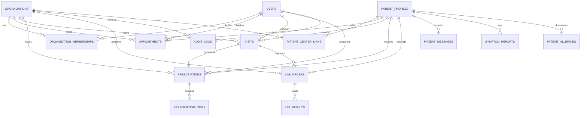

# Database Design & Entity Relationship — Naseej | نَسيج

## 1. Schema Overview

The database design adheres to 3NF normalization, foreign key constraints with cascading rules, strict indexing for tenant isolation (`organization_id`), and timestamp tracking for auditability.

---

## 2. Table Specifications

### 2.1 Organizations & Identity

#### `organizations` (Medical Centers)
- `id` UUID PRIMARY KEY DEFAULT gen_random_uuid()
- `name_ar` VARCHAR(255) NOT NULL
- `name_en` VARCHAR(255) NOT NULL
- `code` VARCHAR(50) UNIQUE NOT NULL (e.g. `AL_NOOR_CLINIC`)
- `type` VARCHAR(50) NOT NULL (e.g. `hospital`, `clinic`, `center`)
- `status` VARCHAR(20) DEFAULT 'active' ('active', 'suspended')
- `contact_phone` VARCHAR(50)
- `contact_email` VARCHAR(100)
- `address` TEXT
- `created_at` TIMESTAMPTZ DEFAULT NOW()
- `updated_at` TIMESTAMPTZ DEFAULT NOW()

#### `users` (System Users)
- `id` UUID PRIMARY KEY DEFAULT gen_random_uuid()
- `auth_provider_id` VARCHAR(255) UNIQUE NOT NULL (User identity key)
- `email` VARCHAR(255) UNIQUE NOT NULL
- `password_hash` VARCHAR(255) (Used by local auth provider)
- `full_name_ar` VARCHAR(255) NOT NULL
- `full_name_en` VARCHAR(255) NOT NULL
- `phone` VARCHAR(50)
- `national_id` VARCHAR(50)
- `system_role` VARCHAR(50) DEFAULT 'user' ('platform_admin', 'user')
- `is_active` BOOLEAN DEFAULT TRUE
- `created_at` TIMESTAMPTZ DEFAULT NOW()
- `updated_at` TIMESTAMPTZ DEFAULT NOW()

#### `organization_memberships` (User-Center Staff Affiliation)
- `id` UUID PRIMARY KEY DEFAULT gen_random_uuid()
- `organization_id` UUID NOT NULL REFERENCES organizations(id) ON DELETE CASCADE
- `user_id` UUID NOT NULL REFERENCES users(id) ON DELETE CASCADE
- `role` VARCHAR(50) NOT NULL ('center_manager', 'doctor', 'reception')
- `specialty` VARCHAR(100) (e.g. 'Cardiology', 'General Practice')
- `license_number` VARCHAR(100)
- `status` VARCHAR(20) DEFAULT 'active' ('active', 'inactive')
- `created_at` TIMESTAMPTZ DEFAULT NOW()
- `updated_at` TIMESTAMPTZ DEFAULT NOW()
- CONSTRAINT unique_user_org UNIQUE (organization_id, user_id)

---

### 2.2 Patient Domain

#### `patient_profiles` (Master Patient Identity)
- `id` UUID PRIMARY KEY DEFAULT gen_random_uuid()
- `user_id` UUID UNIQUE REFERENCES users(id) ON DELETE SET NULL (Optional link to self-service patient user account)
- `national_id` VARCHAR(50) UNIQUE NOT NULL
- `full_name_ar` VARCHAR(255) NOT NULL
- `full_name_en` VARCHAR(255) NOT NULL
- `date_of_birth` DATE NOT NULL
- `gender` VARCHAR(10) NOT NULL ('male', 'female')
- `blood_type` VARCHAR(5)
- `phone` VARCHAR(50) NOT NULL
- `email` VARCHAR(255)
- `emergency_contact_name` VARCHAR(255)
- `emergency_contact_phone` VARCHAR(50)
- `created_at` TIMESTAMPTZ DEFAULT NOW()
- `updated_at` TIMESTAMPTZ DEFAULT NOW()

#### `patient_allergies` (Critical Safety Table)
- `id` UUID PRIMARY KEY DEFAULT gen_random_uuid()
- `patient_id` UUID NOT NULL REFERENCES patient_profiles(id) ON DELETE CASCADE
- `allergen` VARCHAR(255) NOT NULL
- `reaction` TEXT
- `severity` VARCHAR(20) NOT NULL ('mild', 'moderate', 'severe', 'life_threatening')
- `diagnosed_at` DATE
- `created_at` TIMESTAMPTZ DEFAULT NOW()

#### `patient_center_links` (Patient-Center Relationship)
- `id` UUID PRIMARY KEY DEFAULT gen_random_uuid()
- `organization_id` UUID NOT NULL REFERENCES organizations(id) ON DELETE CASCADE
- `patient_id` UUID NOT NULL REFERENCES patient_profiles(id) ON DELETE CASCADE
- `mrn` VARCHAR(100) NOT NULL (Medical Record Number unique to this center)
- `status` VARCHAR(20) DEFAULT 'active' ('active', 'inactive')
- `first_visit_date` DATE
- `created_at` TIMESTAMPTZ DEFAULT NOW()
- CONSTRAINT unique_org_patient UNIQUE (organization_id, patient_id),
- CONSTRAINT unique_org_mrn UNIQUE (organization_id, mrn)

#### `patient_consents` (Cross-Center Sharing Foundation)
- `id` UUID PRIMARY KEY DEFAULT gen_random_uuid()
- `patient_id` UUID NOT NULL REFERENCES patient_profiles(id) ON DELETE CASCADE
- `from_organization_id` UUID NOT NULL REFERENCES organizations(id) ON DELETE CASCADE
- `to_organization_id` UUID NOT NULL REFERENCES organizations(id) ON DELETE CASCADE
- `scope` VARCHAR(50) NOT NULL ('all', 'visits', 'labs', 'prescriptions')
- `status` VARCHAR(20) DEFAULT 'active' ('active', 'revoked', 'expired')
- `granted_at` TIMESTAMPTZ DEFAULT NOW()
- `expires_at` TIMESTAMPTZ NOT NULL
- `revoked_at` TIMESTAMPTZ
- `created_at` TIMESTAMPTZ DEFAULT NOW()

---

### 2.3 Appointments & Clinical Workflows

#### `clinician_schedules` (Availability Slots)
- `id` UUID PRIMARY KEY DEFAULT gen_random_uuid()
- `organization_id` UUID NOT NULL REFERENCES organizations(id) ON DELETE CASCADE
- `clinician_id` UUID NOT NULL REFERENCES users(id) ON DELETE CASCADE
- `day_of_week` INT NOT NULL (0 = Sunday, 1 = Monday, ..., 6 = Saturday)
- `start_time` TIME NOT NULL
- `end_time` TIME NOT NULL
- `slot_duration_minutes` INT DEFAULT 30
- `is_active` BOOLEAN DEFAULT TRUE
- `created_at` TIMESTAMPTZ DEFAULT NOW()

#### `appointments`
- `id` UUID PRIMARY KEY DEFAULT gen_random_uuid()
- `organization_id` UUID NOT NULL REFERENCES organizations(id) ON DELETE CASCADE
- `patient_id` UUID NOT NULL REFERENCES patient_profiles(id) ON DELETE CASCADE
- `clinician_id` UUID NOT NULL REFERENCES users(id) ON DELETE CASCADE
- `appointment_date` DATE NOT NULL
- `start_time` TIME NOT NULL
- `end_time` TIME NOT NULL
- `status` VARCHAR(30) DEFAULT 'pending' ('pending', 'confirmed', 'checked_in', 'in_consultation', 'completed', 'cancelled')
- `reason` TEXT
- `check_in_time` TIMESTAMPTZ
- `created_by` UUID REFERENCES users(id)
- `created_at` TIMESTAMPTZ DEFAULT NOW()
- `updated_at` TIMESTAMPTZ DEFAULT NOW()
- CONSTRAINT unique_clinician_slot UNIQUE (organization_id, clinician_id, appointment_date, start_time)

#### `visits` (Clinical Consultations)
- `id` UUID PRIMARY KEY DEFAULT gen_random_uuid()
- `organization_id` UUID NOT NULL REFERENCES organizations(id) ON DELETE CASCADE
- `patient_id` UUID NOT NULL REFERENCES patient_profiles(id) ON DELETE CASCADE
- `clinician_id` UUID NOT NULL REFERENCES users(id) ON DELETE CASCADE
- `appointment_id` UUID REFERENCES appointments(id) ON DELETE SET NULL
- `visit_date` TIMESTAMPTZ DEFAULT NOW()
- `chief_complaint` TEXT NOT NULL
- `vital_signs` JSONB DEFAULT '{}' (bp, pulse, temp, spo2, weight)
- `examination_notes` TEXT
- `diagnosis` TEXT NOT NULL
- `treatment_plan` TEXT
- `status` VARCHAR(20) DEFAULT 'draft' ('draft', 'approved', 'amended')
- `approved_by` UUID REFERENCES users(id)
- `approved_at` TIMESTAMPTZ
- `created_at` TIMESTAMPTZ DEFAULT NOW()
- `updated_at` TIMESTAMPTZ DEFAULT NOW()

#### `prescriptions`
- `id` UUID PRIMARY KEY DEFAULT gen_random_uuid()
- `organization_id` UUID NOT NULL REFERENCES organizations(id) ON DELETE CASCADE
- `visit_id` UUID NOT NULL REFERENCES visits(id) ON DELETE CASCADE
- `patient_id` UUID NOT NULL REFERENCES patient_profiles(id) ON DELETE CASCADE
- `clinician_id` UUID NOT NULL REFERENCES users(id) ON DELETE CASCADE
- `notes` TEXT
- `status` VARCHAR(20) DEFAULT 'draft' ('draft', 'approved', 'dispensed', 'cancelled')
- `approved_by` UUID REFERENCES users(id)
- `approved_at` TIMESTAMPTZ
- `created_at` TIMESTAMPTZ DEFAULT NOW()
- `updated_at` TIMESTAMPTZ DEFAULT NOW()

#### `prescription_items`
- `id` UUID PRIMARY KEY DEFAULT gen_random_uuid()
- `prescription_id` UUID NOT NULL REFERENCES prescriptions(id) ON DELETE CASCADE
- `medication_name` VARCHAR(255) NOT NULL
- `dosage` VARCHAR(100) NOT NULL (e.g. '500mg')
- `frequency` VARCHAR(100) NOT NULL (e.g. 'Twice daily after meals')
- `duration` VARCHAR(100) NOT NULL (e.g. '7 days')
- `instructions` TEXT
- `created_at` TIMESTAMPTZ DEFAULT NOW()

#### `lab_orders`
- `id` UUID PRIMARY KEY DEFAULT gen_random_uuid()
- `organization_id` UUID NOT NULL REFERENCES organizations(id) ON DELETE CASCADE
- `visit_id` UUID REFERENCES visits(id) ON DELETE SET NULL
- `patient_id` UUID NOT NULL REFERENCES patient_profiles(id) ON DELETE CASCADE
- `clinician_id` UUID NOT NULL REFERENCES users(id) ON DELETE CASCADE
- `test_name` VARCHAR(255) NOT NULL
- `test_category` VARCHAR(100) (e.g. 'Hematology', 'Biochemistry')
- `clinical_notes` TEXT
- `status` VARCHAR(30) DEFAULT 'pending' ('pending', 'sample_collected', 'completed', 'cancelled')
- `created_at` TIMESTAMPTZ DEFAULT NOW()
- `updated_at` TIMESTAMPTZ DEFAULT NOW()

#### `lab_results`
- `id` UUID PRIMARY KEY DEFAULT gen_random_uuid()
- `organization_id` UUID NOT NULL REFERENCES organizations(id) ON DELETE CASCADE
- `lab_order_id` UUID NOT NULL REFERENCES lab_orders(id) ON DELETE CASCADE
- `parameter_name` VARCHAR(255) NOT NULL (e.g. 'Hemoglobin', 'Fasting Blood Glucose')
- `value` VARCHAR(100) NOT NULL
- `unit` VARCHAR(50) NOT NULL (e.g. 'g/dL', 'mg/dL')
- `reference_range` VARCHAR(100) (e.g. '13.8 - 17.2')
- `is_abnormal` BOOLEAN DEFAULT FALSE
- `status` VARCHAR(20) DEFAULT 'draft' ('draft', 'approved')
- `reviewed_by` UUID REFERENCES users(id)
- `reviewed_at` TIMESTAMPTZ
- `created_at` TIMESTAMPTZ DEFAULT NOW()
- `updated_at` TIMESTAMPTZ DEFAULT NOW()

---

### 2.4 Patient Portal & Communication

#### `patient_messages` (Questions & Requests)
- `id` UUID PRIMARY KEY DEFAULT gen_random_uuid()
- `organization_id` UUID NOT NULL REFERENCES organizations(id) ON DELETE CASCADE
- `patient_id` UUID NOT NULL REFERENCES patient_profiles(id) ON DELETE CASCADE
- `subject` VARCHAR(255) NOT NULL
- `body` TEXT NOT NULL
- `category` VARCHAR(50) DEFAULT 'medical' ('medical', 'administrative', 'prescription_refill')
- `status` VARCHAR(20) DEFAULT 'submitted' ('submitted', 'under_review', 'resolved')
- `response` TEXT
- `responded_by` UUID REFERENCES users(id)
- `responded_at` TIMESTAMPTZ
- `created_at` TIMESTAMPTZ DEFAULT NOW()
- `updated_at` TIMESTAMPTZ DEFAULT NOW()

#### `symptom_reports` (Patient Logs)
- `id` UUID PRIMARY KEY DEFAULT gen_random_uuid()
- `patient_id` UUID NOT NULL REFERENCES patient_profiles(id) ON DELETE CASCADE
- `organization_id` UUID REFERENCES organizations(id) ON DELETE SET NULL
- `symptom_description` TEXT NOT NULL
- `severity` INT NOT NULL (Scale 1 - 10)
- `onset_date` TIMESTAMPTZ NOT NULL
- `created_at` TIMESTAMPTZ DEFAULT NOW()

---

### 2.5 Security, Documents & Audit

#### `documents` (Protected File Storage References)
- `id` UUID PRIMARY KEY DEFAULT gen_random_uuid()
- `organization_id` UUID NOT NULL REFERENCES organizations(id) ON DELETE CASCADE
- `patient_id` UUID NOT NULL REFERENCES patient_profiles(id) ON DELETE CASCADE
- `file_name` VARCHAR(255) NOT NULL
- `storage_path` VARCHAR(500) NOT NULL (Local disk path outside web root)
- `mime_type` VARCHAR(100) NOT NULL
- `file_size` BIGINT NOT NULL
- `uploaded_by` UUID NOT NULL REFERENCES users(id)
- `created_at` TIMESTAMPTZ DEFAULT NOW()

#### `audit_logs` (Tamper-Resistant Security Trail)
- `id` UUID PRIMARY KEY DEFAULT gen_random_uuid()
- `organization_id` UUID REFERENCES organizations(id) ON DELETE SET NULL
- `actor_id` UUID REFERENCES users(id) ON DELETE SET NULL
- `actor_role` VARCHAR(50)
- `action` VARCHAR(100) NOT NULL (e.g. 'VISIT_APPROVE', 'APPOINTMENT_CREATE', 'AUTH_LOGIN')
- `resource_type` VARCHAR(50) NOT NULL (e.g. 'visit', 'prescription', 'patient')
- `resource_id` VARCHAR(100)
- `ip_address` VARCHAR(50)
- `details` JSONB DEFAULT '{}'
- `created_at` TIMESTAMPTZ DEFAULT NOW()
- *Note*: No UPDATE or DELETE privileges are granted on this table in application runtime.

#### `demo_requests` (Public Website Inquiries)
- `id` UUID PRIMARY KEY DEFAULT gen_random_uuid()
- `organization_name` VARCHAR(255) NOT NULL
- `contact_name` VARCHAR(255) NOT NULL
- `email` VARCHAR(255) NOT NULL
- `phone` VARCHAR(50) NOT NULL
- `center_type` VARCHAR(50) NOT NULL
- `notes` TEXT
- `status` VARCHAR(20) DEFAULT 'new' ('new', 'contacted', 'scheduled', 'completed')
- `created_at` TIMESTAMPTZ DEFAULT NOW()
