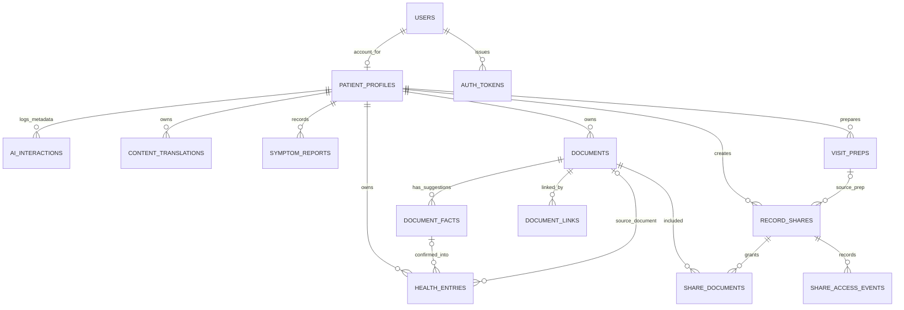
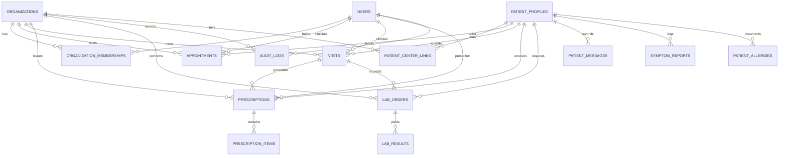

# Database Design & Entity Relationship — Naseej | نَسيج

> **Scope note:** the app is patient-only. The active data model is described in "Active data model" below and drawn in [the ERD diagram](../diagrams/exports/12-erd.png) (editable source `diagrams/source/erd-diagram.drawio`, mapped to relational form in `diagrams/exports/13-erd-mapping.pdf`). Sections 1-4 describe the earlier multi-center platform (organizations, memberships, appointments, visits, prescriptions, labs, consents, care coordination, caregivers, ops messages, demo requests). Those tables stay in the schema but are unused, except `users`, `patient_profiles`, approved `visits`/`prescriptions`/`lab_*` read by the portal summary, `documents`, `document_*`, `patient_allergies`, `symptom_reports`, `audit_logs` and `notifications`. Migrations 005-007 add the patient-owned tables.

## Active data model (patient-owned record)

Migrations `001` to `007`, each with a rollback in `database/migrations/rollback/` (except `001`). Every private table is reached through `patient_profiles`, and the server filters each query by the session's patient profile.

| Migration | Adds |
|---|---|
| 001 | Initial multi-center schema (organizations, users, patient profiles, appointments, visits, prescriptions, labs, documents, audit) |
| 002 | Longitudinal record and coordination (section 3) |
| 003 | Caregivers, ops messages, AI review of documents (section 3b) |
| 004 | Notifications (section 4) |
| 005 | Patient-owned record: health entries, document links, visit preparations, QR shares, access events, AI interaction log (section 5) |
| 006 | `content_translations` (section 6) |
| 007 | Account access: email confirmation, password reset, optional profile fields (section 7) |

## 1. Legacy multi-center overview (migration 001, unused)

The database design adheres to 3NF normalization, foreign key constraints with cascading rules, strict indexing for tenant isolation (`organization_id`), and timestamp tracking for auditability.

---

## 2. Table specifications (migrations 001-003)

### 2.1 Organizations & Identity

#### `organizations` (Medical Centers)
- `id` UUID PRIMARY KEY DEFAULT gen_random_uuid()
- `name_ar` VARCHAR(255) NOT NULL
- `name_en` VARCHAR(255) NOT NULL
- `code` VARCHAR(50) UNIQUE NOT NULL (e.g. `AL_NOOR_CLINIC`)
- `type` VARCHAR(50) NOT NULL (e.g. `hospital`, `clinic`, `center`)
- `status` VARCHAR(20) DEFAULT 'active' ('active', 'suspended')
- `contact_phone` VARCHAR(50)
- `contact_email` VARCHAR(100)
- `address_ar` TEXT
- `address_en` TEXT
- `created_at` TIMESTAMPTZ DEFAULT NOW()
- `updated_at` TIMESTAMPTZ DEFAULT NOW()

#### `users` (System Users)
- `id` UUID PRIMARY KEY DEFAULT gen_random_uuid()
- `auth_provider_id` VARCHAR(255) UNIQUE NOT NULL (User identity key)
- `email` VARCHAR(255) UNIQUE NOT NULL
- `password_hash` VARCHAR(255) (Used by local auth provider)
- `full_name_ar` VARCHAR(255) NOT NULL
- `full_name_en` VARCHAR(255) NOT NULL
- `phone` VARCHAR(50)
- `national_id` VARCHAR(50)
- `system_role` VARCHAR(50) DEFAULT 'user' ('platform_admin', 'user')
- `is_active` BOOLEAN DEFAULT TRUE
- `created_at` TIMESTAMPTZ DEFAULT NOW()
- `updated_at` TIMESTAMPTZ DEFAULT NOW()

#### `organization_memberships` (User-Center Staff Affiliation)
- `id` UUID PRIMARY KEY DEFAULT gen_random_uuid()
- `organization_id` UUID NOT NULL REFERENCES organizations(id) ON DELETE CASCADE
- `user_id` UUID NOT NULL REFERENCES users(id) ON DELETE CASCADE
- `role` VARCHAR(50) NOT NULL ('center_manager', 'doctor', 'reception')
- `specialty_ar` VARCHAR(100)
- `specialty_en` VARCHAR(100)
- `license_number` VARCHAR(100)
- `status` VARCHAR(20) DEFAULT 'active' ('active', 'inactive')
- `created_at` TIMESTAMPTZ DEFAULT NOW()
- `updated_at` TIMESTAMPTZ DEFAULT NOW()
- CONSTRAINT unique_user_org UNIQUE (organization_id, user_id)

---

### 2.2 Patient Domain

#### `patient_profiles` (Master Patient Identity)
- `id` UUID PRIMARY KEY DEFAULT gen_random_uuid()
- `user_id` UUID UNIQUE REFERENCES users(id) ON DELETE SET NULL (Optional link to self-service patient user account)
- `national_id` VARCHAR(50) UNIQUE NOT NULL
- `full_name_ar` VARCHAR(255) NOT NULL
- `full_name_en` VARCHAR(255) NOT NULL
- `date_of_birth` DATE NOT NULL
- `gender` VARCHAR(10) NOT NULL ('male', 'female')
- `blood_type` VARCHAR(5)
- `phone` VARCHAR(50) NOT NULL
- `email` VARCHAR(255)
- `emergency_contact_name` VARCHAR(255)
- `emergency_contact_phone` VARCHAR(50)
- `created_at` TIMESTAMPTZ DEFAULT NOW()
- `updated_at` TIMESTAMPTZ DEFAULT NOW()

#### `patient_allergies` (Critical Safety Table)
- `id` UUID PRIMARY KEY DEFAULT gen_random_uuid()
- `patient_id` UUID NOT NULL REFERENCES patient_profiles(id) ON DELETE CASCADE
- `allergen_ar` VARCHAR(255) NOT NULL
- `allergen_en` VARCHAR(255) NOT NULL
- `reaction_ar` TEXT
- `reaction_en` TEXT
- `severity` VARCHAR(20) NOT NULL ('mild', 'moderate', 'severe', 'life_threatening')
- `diagnosed_at` DATE
- `created_at` TIMESTAMPTZ DEFAULT NOW()

#### `patient_center_links` (Patient-Center Relationship)
- `id` UUID PRIMARY KEY DEFAULT gen_random_uuid()
- `organization_id` UUID NOT NULL REFERENCES organizations(id) ON DELETE CASCADE
- `patient_id` UUID NOT NULL REFERENCES patient_profiles(id) ON DELETE CASCADE
- `mrn` VARCHAR(100) NOT NULL (Medical Record Number unique to this center)
- `status` VARCHAR(20) DEFAULT 'active' ('active', 'inactive')
- `first_visit_date` DATE
- `created_at` TIMESTAMPTZ DEFAULT NOW()
- CONSTRAINT unique_org_patient UNIQUE (organization_id, patient_id),
- CONSTRAINT unique_org_mrn UNIQUE (organization_id, mrn)

#### `patient_consents` (Cross-Center Sharing Foundation)
- `id` UUID PRIMARY KEY DEFAULT gen_random_uuid()
- `patient_id` UUID NOT NULL REFERENCES patient_profiles(id) ON DELETE CASCADE
- `from_organization_id` UUID NOT NULL REFERENCES organizations(id) ON DELETE CASCADE
- `to_organization_id` UUID NOT NULL REFERENCES organizations(id) ON DELETE CASCADE
- `scope` VARCHAR(50) NOT NULL ('all', 'visits', 'labs', 'prescriptions')
- `status` VARCHAR(20) DEFAULT 'active' ('active', 'revoked', 'expired')
- `granted_at` TIMESTAMPTZ DEFAULT NOW()
- `expires_at` TIMESTAMPTZ NOT NULL
- `revoked_at` TIMESTAMPTZ
- `created_at` TIMESTAMPTZ DEFAULT NOW()

---

### 2.3 Appointments & Clinical Workflows

#### `clinician_schedules` (Availability Slots)
- `id` UUID PRIMARY KEY DEFAULT gen_random_uuid()
- `organization_id` UUID NOT NULL REFERENCES organizations(id) ON DELETE CASCADE
- `clinician_id` UUID NOT NULL REFERENCES users(id) ON DELETE CASCADE
- `day_of_week` INT NOT NULL (0 = Sunday, 1 = Monday, ..., 6 = Saturday)
- `start_time` TIME NOT NULL
- `end_time` TIME NOT NULL
- `slot_duration_minutes` INT DEFAULT 30
- `is_active` BOOLEAN DEFAULT TRUE
- `created_at` TIMESTAMPTZ DEFAULT NOW()

#### `appointments`
- `id` UUID PRIMARY KEY DEFAULT gen_random_uuid()
- `organization_id` UUID NOT NULL REFERENCES organizations(id) ON DELETE CASCADE
- `patient_id` UUID NOT NULL REFERENCES patient_profiles(id) ON DELETE CASCADE
- `clinician_id` UUID NOT NULL REFERENCES users(id) ON DELETE CASCADE
- `appointment_date` DATE NOT NULL
- `start_time` TIME NOT NULL
- `end_time` TIME NOT NULL
- `status` VARCHAR(30) DEFAULT 'pending' ('pending', 'confirmed', 'checked_in', 'in_consultation', 'completed', 'cancelled', 'no_show')
- `reason` TEXT
- `check_in_time` TIMESTAMPTZ
- `created_by` UUID REFERENCES users(id)
- `created_at` TIMESTAMPTZ DEFAULT NOW()
- `updated_at` TIMESTAMPTZ DEFAULT NOW()
- CONSTRAINT unique_clinician_slot UNIQUE (organization_id, clinician_id, appointment_date, start_time)

#### `visits` (Clinical Consultations)
- `id` UUID PRIMARY KEY DEFAULT gen_random_uuid()
- `organization_id` UUID NOT NULL REFERENCES organizations(id) ON DELETE CASCADE
- `patient_id` UUID NOT NULL REFERENCES patient_profiles(id) ON DELETE CASCADE
- `clinician_id` UUID NOT NULL REFERENCES users(id) ON DELETE CASCADE
- `appointment_id` UUID REFERENCES appointments(id) ON DELETE SET NULL
- `visit_date` TIMESTAMPTZ DEFAULT NOW()
- `chief_complaint` TEXT NOT NULL
- `vital_signs` JSONB DEFAULT '{}' (bp, pulse, temp, spo2, weight)
- `examination_notes` TEXT
- `diagnosis` TEXT NOT NULL
- `treatment_plan` TEXT
- `status` VARCHAR(20) DEFAULT 'draft' ('draft', 'approved', 'amended')
- `approved_by` UUID REFERENCES users(id)
- `approved_at` TIMESTAMPTZ
- `created_at` TIMESTAMPTZ DEFAULT NOW()
- `updated_at` TIMESTAMPTZ DEFAULT NOW()

#### `prescriptions`
- `id` UUID PRIMARY KEY DEFAULT gen_random_uuid()
- `organization_id` UUID NOT NULL REFERENCES organizations(id) ON DELETE CASCADE
- `visit_id` UUID NOT NULL REFERENCES visits(id) ON DELETE CASCADE
- `patient_id` UUID NOT NULL REFERENCES patient_profiles(id) ON DELETE CASCADE
- `clinician_id` UUID NOT NULL REFERENCES users(id) ON DELETE CASCADE
- `notes` TEXT
- `status` VARCHAR(20) DEFAULT 'draft' ('draft', 'approved', 'dispensed', 'cancelled')
- `approved_by` UUID REFERENCES users(id)
- `approved_at` TIMESTAMPTZ
- `created_at` TIMESTAMPTZ DEFAULT NOW()
- `updated_at` TIMESTAMPTZ DEFAULT NOW()

#### `prescription_items`
- `id` UUID PRIMARY KEY DEFAULT gen_random_uuid()
- `prescription_id` UUID NOT NULL REFERENCES prescriptions(id) ON DELETE CASCADE
- `medication_name` VARCHAR(255) NOT NULL
- `dosage` VARCHAR(100) NOT NULL (e.g. '500mg')
- `frequency` VARCHAR(100) NOT NULL (e.g. 'Twice daily after meals')
- `duration` VARCHAR(100) NOT NULL (e.g. '7 days')
- `instructions` TEXT
- `created_at` TIMESTAMPTZ DEFAULT NOW()

#### `lab_orders`
- `id` UUID PRIMARY KEY DEFAULT gen_random_uuid()
- `organization_id` UUID NOT NULL REFERENCES organizations(id) ON DELETE CASCADE
- `visit_id` UUID REFERENCES visits(id) ON DELETE SET NULL
- `patient_id` UUID NOT NULL REFERENCES patient_profiles(id) ON DELETE CASCADE
- `clinician_id` UUID NOT NULL REFERENCES users(id) ON DELETE CASCADE
- `test_name_ar` VARCHAR(255) NOT NULL
- `test_name_en` VARCHAR(255) NOT NULL
- `test_category` VARCHAR(100) (e.g. 'Hematology', 'Biochemistry')
- `clinical_notes` TEXT
- `status` VARCHAR(30) DEFAULT 'pending' ('pending', 'sample_collected', 'completed', 'cancelled')
- `created_at` TIMESTAMPTZ DEFAULT NOW()
- `updated_at` TIMESTAMPTZ DEFAULT NOW()

#### `lab_results`
- `id` UUID PRIMARY KEY DEFAULT gen_random_uuid()
- `organization_id` UUID NOT NULL REFERENCES organizations(id) ON DELETE CASCADE
- `lab_order_id` UUID NOT NULL REFERENCES lab_orders(id) ON DELETE CASCADE
- `parameter_name` VARCHAR(255) NOT NULL (e.g. 'Hemoglobin', 'Fasting Blood Glucose')
- `value` VARCHAR(100) NOT NULL
- `unit` VARCHAR(50) NOT NULL (e.g. 'g/dL', 'mg/dL')
- `reference_range` VARCHAR(100) (e.g. '13.8 - 17.2')
- `is_abnormal` BOOLEAN DEFAULT FALSE
- `status` VARCHAR(20) DEFAULT 'draft' ('draft', 'approved')
- `reviewed_by` UUID REFERENCES users(id)
- `reviewed_at` TIMESTAMPTZ
- `created_at` TIMESTAMPTZ DEFAULT NOW()
- `updated_at` TIMESTAMPTZ DEFAULT NOW()

---

### 2.4 Patient Portal & Communication

#### `patient_messages` (Questions & Requests)
- `id` UUID PRIMARY KEY DEFAULT gen_random_uuid()
- `organization_id` UUID NOT NULL REFERENCES organizations(id) ON DELETE CASCADE
- `patient_id` UUID NOT NULL REFERENCES patient_profiles(id) ON DELETE CASCADE
- `subject` VARCHAR(255) NOT NULL
- `body` TEXT NOT NULL
- `category` VARCHAR(50) DEFAULT 'medical' ('medical', 'administrative', 'prescription_refill')
- `status` VARCHAR(20) DEFAULT 'submitted' ('submitted', 'under_review', 'resolved')
- `response` TEXT
- `responded_by` UUID REFERENCES users(id)
- `responded_at` TIMESTAMPTZ
- `created_at` TIMESTAMPTZ DEFAULT NOW()
- `updated_at` TIMESTAMPTZ DEFAULT NOW()

#### `symptom_reports` (Patient Logs)
- `id` UUID PRIMARY KEY DEFAULT gen_random_uuid()
- `patient_id` UUID NOT NULL REFERENCES patient_profiles(id) ON DELETE CASCADE
- `organization_id` UUID REFERENCES organizations(id) ON DELETE SET NULL
- `symptom_description` TEXT NOT NULL
- `severity` INT NOT NULL (Scale 1 - 10)
- `onset_date` TIMESTAMPTZ NOT NULL
- `created_at` TIMESTAMPTZ DEFAULT NOW()

---

### 2.5 Security, Documents & Audit

#### `documents` (Protected File Storage References)
- `id` UUID PRIMARY KEY DEFAULT gen_random_uuid()
- `organization_id` UUID NOT NULL REFERENCES organizations(id) ON DELETE CASCADE
- `patient_id` UUID NOT NULL REFERENCES patient_profiles(id) ON DELETE CASCADE
- `file_name` VARCHAR(255) NOT NULL
- `storage_path` VARCHAR(500) NOT NULL (Local disk path outside web root)
- `mime_type` VARCHAR(100) NOT NULL
- `file_size` BIGINT NOT NULL
- `uploaded_by` UUID NOT NULL REFERENCES users(id)
- `created_at` TIMESTAMPTZ DEFAULT NOW()

#### `audit_logs` (Tamper-Resistant Security Trail)
- `id` UUID PRIMARY KEY DEFAULT gen_random_uuid()
- `organization_id` UUID REFERENCES organizations(id) ON DELETE SET NULL
- `actor_id` UUID REFERENCES users(id) ON DELETE SET NULL
- `actor_role` VARCHAR(50)
- `action` VARCHAR(100) NOT NULL (e.g. 'VISIT_APPROVE', 'APPOINTMENT_CREATE', 'AUTH_LOGIN')
- `resource_type` VARCHAR(50) NOT NULL (e.g. 'visit', 'prescription', 'patient')
- `resource_id` VARCHAR(100)
- `ip_address` VARCHAR(50)
- `details` JSONB DEFAULT '{}'
- `created_at` TIMESTAMPTZ DEFAULT NOW()
- *Note*: No UPDATE or DELETE privileges are granted on this table in application runtime.

#### `demo_requests` (Public Website Inquiries)
- `id` UUID PRIMARY KEY DEFAULT gen_random_uuid()
- `organization_name` VARCHAR(255) NOT NULL
- `contact_name` VARCHAR(255) NOT NULL
- `email` VARCHAR(255) NOT NULL
- `phone` VARCHAR(50) NOT NULL
- `center_type` VARCHAR(50) NOT NULL
- `notes` TEXT
- `status` VARCHAR(20) DEFAULT 'new' ('new', 'contacted', 'scheduled', 'completed')
- `created_at` TIMESTAMPTZ DEFAULT NOW()

## 3. Migration 002: longitudinal record and coordination

Additive and reversible (`database/migrations/rollback/002_down.sql`), applied by the tracked runner (`npm --prefix backend run migrate`). Adds `care_cases`, `care_tasks`, `care_referrals`, `care_followup_log` (append-only), provenance/review/visibility columns and `NOT VALID` check constraints on `documents`, consent status/scope constraints, the `care_coordinator` membership role, and indexes for timeline paging.
`npm --prefix backend run migrate -- --reset` re-runs everything from 001 and **destroys data**; the API test suite changes state, so reseed (`migrate -- --reset` then `seed`) before re-running it.

## 3b. Migration 003: caregivers, operational messages, AI review of documents

Additive and reversible (`rollback/003_down.sql`). Adds `caregiver_delegations` (access a patient grants to a caregiver account, per capability, expiring), `ops_messages` and `ops_message_replies` (reception to clinician messages without clinical content), `patient_messages.sent_by_caregiver_id`, `documents.ai_processing_allowed`, and the document-reading tables `document_processing` (one row per document: status, provider, model, suggested type) and `document_facts` (readings kept apart from verified data). Only `document_processing` and `document_facts` are still used by the patient-only app; the rest is unused.

## 4. Migration 004: notifications

Additive and reversible (`database/migrations/rollback/004_down.sql`). One table, `notifications`:
- `id`, `recipient_user_id` (FK users, cascade), `recipient_role` (the role the person holds for this item), `organization_id` (nullable, FK organizations)
- `event_type`, `category`, `params` (JSONB, allow-listed non-sensitive values only: dates, times, record kind)
- `related_type`, `related_id` (the record concerned), `destination_kind` (a key of the client's typed map, never a URL), `destination_id` (the related record, or the delegation for a caregiver's patient-related item)
- `dedupe_key` with a unique index on `(recipient_user_id, recipient_role, dedupe_key)`
- `created_at`, `read_at` (seen), `handled_at` (set by the server when the record shows the task is done), `dismissed_at`, `expires_at` (set to creation + 90 days; expired items are no longer shown)

Indexes serve the inbox, the unread count and lookup by related record. No clinical text, names or message bodies are stored.

## 5. Migration 005: patient-owned record

Additive and reversible (`rollback/005_down.sql`).

| Table | Purpose and key columns |
|---|---|
| `health_entries` | condition, medication, allergy, procedure, measurement, visit. `kind`, `title`, `status` (active/past), `start_date`, `end_date`, `event_date`, `dose`, `frequency`, `reaction`, `severity`, `value`, `unit`, `provider_name`, `notes`, `source` (patient / assistant / document / clinician), `review_status` (confirmed / needs_review), `source_document_id`, `source_fact_id`, `deleted_at` |
| `symptom_reports` (extended) | + `duration_text`, `frequency`, `better_factors`, `worse_factors`, `captured_via` (form / assistant / voice), `deleted_at`, `updated_at` |
| `documents` (extended) | `organization_id` now nullable (a vault document has no center); + `doc_type`, `provider_name`, `deleted_at` |
| `document_links` | document ↔ symptom / entry / visit of the same patient |
| `document_facts` (extended) | + `patient_decision` (confirmed / rejected), `patient_decided_at`; AI readings stay suggestions until confirmed |
| `visit_preps` | `visit_date`, `status` (draft / approved), `content` JSONB (reason, overview, sections of sourced items), `approved_at` |
| `record_shares` | `patient_id`, `prep_id` (nullable FK to `visit_preps`, set null on delete), `token_hash` CHAR(64) unique (SHA-256 of a 256-bit token), `label`, `snapshot` JSONB (frozen approved content), `expires_at`, `revoked_at`, `view_count`, `last_viewed_at` |
| `share_documents` | documents a share may stream |
| `share_access_events` | `event` (view / document / denied_expired / denied_revoked), `device`, `ip_hash` (keyed, truncated), `occurred_at` |
| `ai_interactions` | metadata only: `kind` (assistant / prep_overview), `outcome` (answered / refused / urgent / error / not_configured), `provider`, `model`, `latency_ms` |
| `patient_profiles` (extended) | `ai_assistant_consent_at` (NULL = never allowed) |

## 6. Migration 006: content translations

Additive and reversible (`rollback/006_down.sql`). One table, `content_translations`, a cache of translations of text the patient typed:
- Primary key `(patient_id, source_hash, target_lang)`; `patient_id` FK to `patient_profiles` (cascade).
- `source_hash` CHAR(64) is the SHA-256 of the original wording, so edited text can never show an old translation. The original text is never copied into this table.
- `source_lang` and `target_lang` are `ar` or `en` and must differ; `translated_text`, `provider` (the engine that made it), `created_at`, `last_used_at`.
- Rows unused for 90 days are pruned. Design: [translation.md](../features/translation.md).

## 7. Migration 007: account access

Additive and reversible (`rollback/007_down.sql`; it removes email-registered accounts first, because they cannot exist under the older constraints).
- `users.email_verified_at` (default `NOW()`, so every earlier and administrator-made account counts as confirmed) and `users.password_changed_at` (a reset signs out older sessions).
- `auth_tokens`: `id`, `user_id` (FK users, cascade), `purpose` (`verify_email` or `reset_password`), `token_hash` CHAR(64) unique (SHA-256 of a 256-bit token), `expires_at`, `used_at`, `created_at`. Tokens are single-use and never stored in clear.
- `patient_profiles.national_id`, `date_of_birth`, `gender` and `phone` become optional, because a self-registered patient does not have them. Design: [accounts.md](../features/accounts.md).
